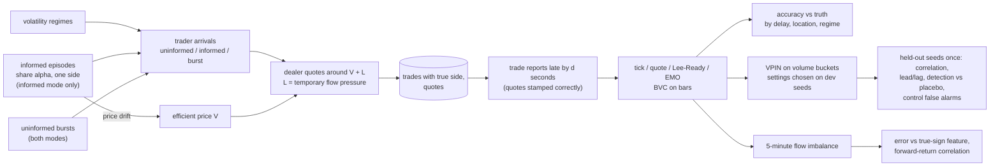

# trade-signing-and-vpin-lab

[](https://github.com/Avinash186200/trade-signing-and-vpin-lab/actions/workflows/ci.yml)
[](LICENSE)


How accurate are the standard trade-signing rules, how does their error reach VPIN and order-flow features, and does VPIN actually warn of informed trading? Measured against a trades-and-quotes simulator where the true initiator of every trade and the informed share at every moment are known.

## Scenario

A trading desk builds order-flow features from trade and quote data. The data says what traded, at what price and when, but not who initiated each trade. So the desk signs trades with a rule (tick rule, Lee-Ready, and so on) and feeds the signed volume into features such as order-flow imbalance and VPIN, a "flow toxicity" measure that is supposed to rise when informed traders are active. Before anyone trusts those features, the desk wants three answers: how often the signing rules are wrong, and when; how much of that error survives into VPIN and imbalance features; and whether VPIN warns of informed trading at all, or just reacts to one-sided flow.

This is a scenario to frame the work. All data here is synthetic, generated by a simulator in this repo with known ground truth, so every number can be rebuilt.

## What it does

| part | what I built | how it is judged |
|---|---|---|
| simulator | trades and quotes in clock time. Uninformed buyers and sellers (Poisson); **informed episodes** where a planted share of traders (15% to 40%) all trade one way and the price drifts with them; **uninformed bursts** (a large parent order split into child trades: one-sided, no information, temporary impact only); low and high volatility regimes; a dealer who re-quotes after trades; trades at the quote, inside the spread and at the midpoint; trade reports that lag the quotes. A **control** mode removes the informed traders and keeps everything else | the true side, trader type and prevailing quote of every trade are stored; tests check the execution rules, the planted share and the control |
| signing | tick rule, quote (midpoint) rule, Lee-Ready, EMO (trade level) and bulk volume classification (bar level) | accuracy against the true side, by reporting delay, by where the trade printed (at the quote, inside, at the mid) and by volatility regime; bar-level volume accuracy against a naive 50/50 split |
| VPIN | VPIN on equal-volume buckets, once per signing method and once with the true signs. Bucket size and window chosen per method on **development seeds only**; alarm threshold = 90th percentile on development control seeds | on **held-out seeds, run once**: correlation with the planted informed share, lead/lag, episode detection against a placebo, false alarms in the control |
| features | trailing 5-minute trade-flow imbalance on 1-minute bars, with each signing method | correlation with the true-sign feature, mean absolute error, correlation with the next 5-minute return |

## How it works



Two design choices carry the experiment. First, the **reporting delay** only re-stamps trades: the same session is signed at delays from 0 to 2 seconds, so any change in accuracy is the delay and nothing else. Second, the **uninformed bursts** appear in both modes. They are one-sided like informed flow but carry no information. If VPIN fires on them in the control, that is a false alarm by construction.

## Results

All numbers are from synthetic data, copied from [results/RESULTS.md](results/RESULTS.md). `make bench` rebuilds every table in about 20 s on a laptop CPU, and CI checks that a fresh run matches the committed JSON (with the versions in `constraints.txt`).

Each mode has 8 development seeds (all choices made there) and 8 held-out seeds (scored once). A session is 6.5 hours of clock time with about 59,000 trades and 53,000 quote updates in informed mode; 86% of trades print at the quote, 5% inside the spread off the mid and 9% at the mid; informed traders make 8% of held-out trades overall (4 episodes a session). ± is one standard error across the 8 held-out seeds.

### 1. Trade-level accuracy: the quote rules win only if trades and quotes line up

Held-out, informed mode. An unclassified trade (the quote rule at the mid) counts as half right.

| trade reporting delay | tick rule | quote rule | Lee-Ready | EMO |
|---|---|---|---|---|
| 0 s | 0.826 ± 0.002 | **0.941** ± 0.001 | 0.940 ± 0.001 | 0.932 ± 0.001 |
| 0.1 s | 0.826 ± 0.002 | 0.886 ± 0.002 | 0.897 ± 0.002 | 0.894 ± 0.002 |
| 0.25 s | 0.826 ± 0.002 | 0.839 ± 0.002 | 0.860 ± 0.002 | 0.860 ± 0.002 |
| 0.5 s | 0.826 ± 0.002 | 0.800 ± 0.002 | 0.827 ± 0.002 | 0.832 ± 0.002 |
| 1 s | **0.826** ± 0.002 | 0.756 ± 0.003 | 0.785 ± 0.003 | 0.799 ± 0.002 |
| 2 s | **0.826** ± 0.002 | 0.706 ± 0.004 | 0.735 ± 0.004 | 0.767 ± 0.002 |

By where the trade printed, at 0 s delay:

| condition | share of trades | tick rule | quote rule | Lee-Ready | EMO |
|---|---|---|---|---|---|
| at the quote | 0.860 | 0.877 | 1.000 | 1.000 | 1.000 |
| inside the spread, not at the mid | 0.054 | 0.560 | 0.700 | 0.700 | 0.560 |
| at the midpoint | 0.086 | 0.486 | 0.500 | 0.486 | 0.486 |
| low-volatility regime | 0.564 | 0.844 | 0.951 | 0.951 | 0.946 |
| high-volatility regime | 0.436 | 0.802 | 0.927 | 0.925 | 0.914 |

- **With aligned timestamps, the quote-based rules are about 11 points better than the tick rule** (0.940 for Lee-Ready against 0.826). At the quote they are always right (a test checks this), so all their errors are inside the spread.
- **A reporting delay of half a second wipes out the advantage, and from 1 second the tick rule is the best rule.** The dealer re-quotes after about half of all trades, a fraction of a second later; a late trade report gets compared with that new quote. Lee-Ready drops from 0.940 to 0.827 at 0.5 s and 0.735 at 2 s. The tick rule never looks at quotes, so it does not move. EMO degrades the slowest of the quote rules because it falls back to the tick rule for any price that is not exactly at the bid or ask.
- **Midpoint trades are coin flips for every rule.** Inside the spread off the mid, the quote rule and Lee-Ready get 0.700 (in this generator 70% of such trades print on the initiator's half, so 0.700 is that tilt, not skill); EMO sends them to the tick rule and gets 0.560.
- **High volatility costs about 2 to 4 points** for every rule (wider spreads, more inside trades). Control-mode numbers are within about 0.01 of these (in RESULTS.md).

### 2. Bar-level accuracy flatters, and BVC is below a naive split

Volume accuracy on equal-volume bars (the sum over bars of min(estimated, true) buy volume plus the same for sells, over total volume). Held-out, informed, 0.5 s delay:

| shares per bar | bars scored per session | tick rule | Lee-Ready | EMO | BVC | naive 50/50 |
|---|---|---|---|---|---|---|
| 2,000 | 6,469 | 0.862 | 0.872 | 0.878 | 0.732 | 0.825 |
| 10,000 | 1,253 | 0.915 | 0.927 | 0.929 | 0.753 | 0.899 |
| 50,000 | 210 | 0.941 | 0.959 | 0.956 | 0.765 | 0.924 |

- **Errors net out inside a bar, so the numbers grow with bar size.** But a rule that calls every bar half buys, half sells already scores 0.899 at 10,000 shares. The signing rules add 1.6 to 3 points over that baseline, not 40.
- **BVC scores 0.753, 15 points below the naive split.** BVC sets a bar's buy share to Φ(price change / σ). Here most of a bar's price change is efficient-price noise and bid-ask bounce, not order flow, so BVC swings the buy share far more than the true flow swings.
- **How much this depends on the simulator:** with the efficient-price noise turned off entirely, BVC's 5-minute imbalance correlates 0.612 with the truth instead of 0.225, but its bar accuracy is still 0.767 against 0.899 for the naive split (sensitivity table in RESULTS.md). On real data, where trades explain more of the price variance, BVC should do better than here; I would not trust it without checking that on the asset in question.

### 3. VPIN: good signing tracks informed trading, but VPIN follows rather than warns

Held-out seeds, each method with its own development-chosen bucket size and window. Correlation is VPIN against the planted informed share on a 1-minute grid. "Placebo" applies the same alarm rule to the control sessions: each control session places episode windows exactly as an informed session would (different seeds, so 29 windows, not 32) and nobody informed trades in them, so it is the hit rate by chance.

| signing (buckets per session x window) | corr with planted share | peak lag (min) | corr with share 10 min later | corr with share 10 min earlier | episodes detected | median delay (min) | placebo windows flagged | alarm share in control | control: in bursts | control: no burst |
|---|---|---|---|---|---|---|---|---|---|---|
| true signs (400 x 5) | **0.679** ± 0.056 | 3 | 0.262 | 0.433 | 32/32 | 2.2 | 10/29 | 9.8% | 31.8% | 0.9% |
| tick rule (100 x 2) | 0.420 ± 0.062 | 5 | 0.100 | 0.430 | 29/32 | 4.4 | 9/29 | 8.8% | 21.7% | 3.6% |
| quote rule (400 x 10) | 0.567 ± 0.057 | 5 | 0.158 | 0.566 | 31/32 | 4.3 | 10/29 | 10.5% | 28.7% | 2.1% |
| Lee-Ready (200 x 2) | 0.560 ± 0.050 | 3 | 0.211 | 0.403 | 32/32 | 3.5 | 17/29 | 9.5% | 23.0% | 3.7% |
| EMO (100 x 2) | 0.577 ± 0.043 | 5 | 0.131 | 0.571 | 31/32 | 4.5 | 9/29 | 9.4% | 26.7% | 1.7% |
| BVC (50 x 2) | 0.115 ± 0.054 | -8 | 0.126 | 0.017 | 11/32 | 0.7 | 10/29 | 14.3% | 13.0% | 13.8% |

- **Signing error costs VPIN a lot.** With true signs VPIN correlates 0.679 with the informed share; with the quote rules at a 0.5 s delay, 0.560 to 0.577; with the tick rule 0.420; with BVC 0.115, about two standard errors from zero.
- **VPIN lags informed trading; it does not lead it.** The correlation peaks with VPIN 3 to 5 minutes behind the planted share, and VPIN correlates less with the share 10 minutes later than with the share 10 minutes earlier for every trade-level rule. This is built in: VPIN averages buckets that have already traded. It can confirm an episode a few minutes in; it cannot see one coming. (BVC's "peak lag" of -8 is the maximum of a flat, low curve.)
- **"Detected 32 of 32" needs the placebo next to it.** An alarm somewhere inside a 24-minute window happens by chance in 9 to 17 of 29 placebo windows. True-sign, quote-rule, Lee-Ready and EMO VPIN beat that clearly (31 or 32 of 32). BVC's 11 of 32 is the same rate as its placebo (10 of 29): no information. An episode already in alarm at its start counts as detected with a delay under one minute (the first grid minute inside it); that happens for 4 to 7 of 32 episodes per method and for 6 of BVC's 11 detections (`already_alarm_at_start` in `vpin.json`), which is why BVC's median delay of 0.7 minutes means nothing.
- **Almost every control false alarm is an uninformed burst.** The development threshold gives about the intended 10% alarm time in the held-out control (8.8% to 10.5% for the trade-level rules). With true signs, VPIN is in alarm 31.8% of the time during and just after uninformed bursts, and 0.9% otherwise. VPIN measures one-sided volume; it cannot tell a large uninformed order from informed trading. BVC alarms 13% to 14% of the time everywhere, bursts or not.
- **The window choice changes the noise, and the development pick is close to a tie.** For the quote rule, Lee-Ready and EMO the best two development cells are within 0.0006 of each other (Lee-Ready: 200 x 2 at 0.5836, 400 x 10 at 0.5832), so which one was picked is luck. Lee-Ready's pick (200 buckets, window 2) is the most jittery: 9.0 false alarm spells per control session against 3.6 for EMO (RESULTS.md), and the highest placebo rate (17 of 29).

### 4. How signing error reaches order-flow features

Trailing 5-minute imbalance (buy volume - sell volume) / volume on 1-minute bars, every method assigning trades to bars by the same reported time. Held-out seeds, 0.5 s delay:

| signing | corr with true-sign imbalance (informed) | mean abs error (informed) | corr with true-sign imbalance (control) | corr with next 5-min return (informed) | corr with next 5-min return (control) |
|---|---|---|---|---|---|
| true signs | 1 | 0 | 1 | 0.069 ± 0.042 | -0.106 ± 0.050 |
| tick rule | 0.794 ± 0.014 | 0.085 | 0.605 ± 0.035 | 0.058 ± 0.037 | -0.057 ± 0.063 |
| quote rule | 0.926 ± 0.008 | 0.059 | 0.823 ± 0.029 | 0.053 ± 0.042 | -0.060 ± 0.038 |
| Lee-Ready | 0.927 ± 0.009 | 0.057 | 0.808 ± 0.033 | 0.061 ± 0.041 | -0.061 ± 0.039 |
| EMO | 0.920 ± 0.008 | 0.063 | 0.789 ± 0.029 | 0.066 ± 0.038 | -0.056 ± 0.046 |
| BVC | 0.225 ± 0.055 | 0.211 | 0.022 ± 0.043 | 0.055 ± 0.035 | -0.047 ± 0.020 |

- **Trade-level errors partly average out over 5 minutes**: an 83% trade-level Lee-Ready accuracy becomes a 0.927 correlation with the true feature. The tick rule keeps 0.794. BVC's feature is mostly noise (0.225).
- **The error matters more when the true signal is small.** In the control, where the true imbalance swings less, the same rules keep only 0.61 to 0.82 of it, because the signing noise is about the same size while the signal shrinks.
- **I cannot rank the methods by forward-return predictive power.** Even the true-sign imbalance correlates only 0.069 ± 0.042 with the next 5-minute return in informed mode, and every method is within one standard error of it. In the control the sign flips (-0.106): one-sided uninformed flow pushes the price temporarily and it reverts. A feature study that only looks at forward returns would not have seen the signing error that the first column shows.

## Key concepts

- **Tick rule.** Buy if the price is above the last different price, sell if below. Needs only trade prices.
- **Quote (midpoint) rule and Lee-Ready.** Buy above the prevailing quote midpoint, sell below. Lee-Ready (Lee and Ready 1991) uses the tick rule for trades exactly at the mid.
- **EMO** (Ellis, Michaely and O'Hara 2000). Buy at the ask, sell at the bid, the tick rule for everything else.
- **Bulk volume classification (BVC).** For a bar of volume V with price change ΔP, buy volume = V · Φ(ΔP / σ) (Easley, López de Prado and O'Hara 2012, 2016). σ here is the standard deviation of the previous 50 bar changes (60 for the 1-minute imbalance bars), so BVC never sees the bar it classifies.
- **VPIN** (Easley, López de Prado and O'Hara 2012). Split volume into equal-volume buckets; VPIN = the average over the last n buckets of |buy volume - sell volume| / bucket volume. A trade that crosses a bucket boundary is split exactly.
- **Planted informed share.** At each time, informed arrivals / all arrivals. During an episode it is the episode's alpha (scaled down if a burst overlaps); otherwise 0. This is the target VPIN is judged against.
- **Reporting delay.** Each trade is stamped `d · U(0.5, 1.5)` seconds late, with a running maximum so the trade feed keeps its order. Quotes are stamped correctly. Every rule matches a trade to the last quote stamped at or before its reported time.
- **Development vs held-out.** Bucket sizes, windows and alarm thresholds come from development seeds; held-out seeds were scored once. History in [docs/methodology.md](docs/methodology.md).
- **Placebo windows.** Each control session places episode windows exactly as an informed session would (different seeds, so 29 windows, not 32) and nobody informed trades in them, so the alarm rule can be run on windows where nothing informed happens.

## Quick start

```bash
pip install -c constraints.txt -e ".[dev]"   # exact versions the results were made with
pytest -q                                     # about 15 s, includes a full rerun against results/
make bench                                    # writes results/{data,accuracy,vpin,ofi}.json and RESULTS.md
make demo                                     # one session's trades and quotes to CSV, with true sides and each rule's signs
```

More in [docs/walkthrough.md](docs/walkthrough.md); the rules behind every number are in [docs/methodology.md](docs/methodology.md).

## Layout

```
src/tsvlab/
  sim.py        trades-and-quotes simulator: arrivals, episodes, bursts, regimes, dealer quotes, reporting delay
  signing.py    tick, quote, Lee-Ready, EMO; BVC with a point-in-time sigma
  bars.py       equal-volume buckets with exact trade splitting; clock-time bars
  vpin.py       VPIN, grid sampling, lagged correlation, episode detection
  analysis.py   per-session accuracy, VPIN series, alarms, imbalance features, session stats
  bench.py      the full run: dev-only selection, one held-out run, RESULTS.md renderer
  cli.py        tsvlab simulate | bench | report
tests/          unit tests per module, point-in-time checks, a small end-to-end run, a full rerun against results/
results/        JSON results and RESULTS.md
docs/           methodology (with references), walkthrough
```

## Companion repo

[lob-tick-model-lowlatency](https://github.com/Avinash186200/lob-tick-model-lowlatency) works one level down: an event-driven limit order book with book-event order-flow imbalance (Cont, Kukanov and Stoikov), a short-horizon move model and a fill-aware backtest. That repo has the book but no trade signing; this one has trades and quotes but no book depth. Together they cover the two common forms of microstructure data.

## Limitations

- **Everything is synthetic, and the results depend on the generator.** Informed traders here are pure: in an episode they all trade one way, at a steady rate, for 15 to 35 minutes. Real informed traders split orders, use limit orders and hide in the flow. VPIN's 0.68 correlation with true signs is a ceiling for this generator, not a forecast for a real market.
- **BVC is at a disadvantage here, by construction of the price process.** Most price variance comes from an efficient-price random walk that has nothing to do with order flow. The noise sensitivity table shows BVC's feature correlation rising from 0.225 to 0.612 as that noise goes to zero; on assets where flow drives more of the price, BVC will look better. My BVC also works on the volume buckets directly, with a normal CDF; the original applies it to 1-minute time bars aggregated into buckets, and later work uses a Student-t CDF.
- **The quote-rule advantage depends on how fast the dealer reacts.** Re-quotes follow trades after 20 ms plus about 150 ms on average, for half of all trades. With slower quote updates, the delay at which the tick rule overtakes Lee-Ready would be longer. The crossover (about 0.5 s here) is a property of this setting, not a general number. Real feeds also have trades and quotes from different venues and clocks.
- **The 0.700 inside-the-spread accuracy is a parameter.** It equals the generator's 70% tilt of inside prints toward the initiator's side of the mid.
- **Trade size carries no information here.** Trade sizes are drawn from the same distribution for every trader, so size cannot reveal informed traders. On real data, size and timing carry information this lab ignores.
- **One day per session, no overnight.** VPIN's original setting (50 buckets a day, a window of 50) needs a day of history before the first value; with one-day sessions the grid stops at windows of a quarter of a session, so the paper's setting is not tested.
- **Detection is generous.** An episode counts as detected if any 1-minute alarm falls inside it. The placebo row is there to show how generous; read detection only against it.
- **No delay correction is tested.** A desk that knows its typical reporting delay can match trades to an earlier quote (Lee and Ready's lag idea); that is not tested here, so the delay table shows the uncorrected cost.
- **No prints outside the quotes, and no locked or crossed quotes.** Every trade prints at or inside the prevailing bid and ask, and the spread is always 1 to 3 ticks. Real feeds have both, and they are where the rules disagree most.
- **The informed price move is scripted.** During an episode the efficient price drifts linearly by a drawn amount; it is not caused by the informed trades, and the dealer learns nothing from flow beyond the temporary pressure L.
- **The delay only makes trades late.** Quotes are stamped correctly and the trade feed keeps its order. Real feeds also have out-of-order trade reports, late quotes and clock differences between venues.
- **Eight held-out seeds per mode.** Standard errors across seeds are shown. The forward-return correlations are too noisy at this sample size to separate the methods.
- **BVC's development choice sits on the edge of the grid** (the largest buckets). Its correlation is low across the whole grid (at most 0.21), so a wider grid would not change the conclusion.

## References

Full references are in [docs/methodology.md](docs/methodology.md#references).

## License

MIT. See [LICENSE](LICENSE).
